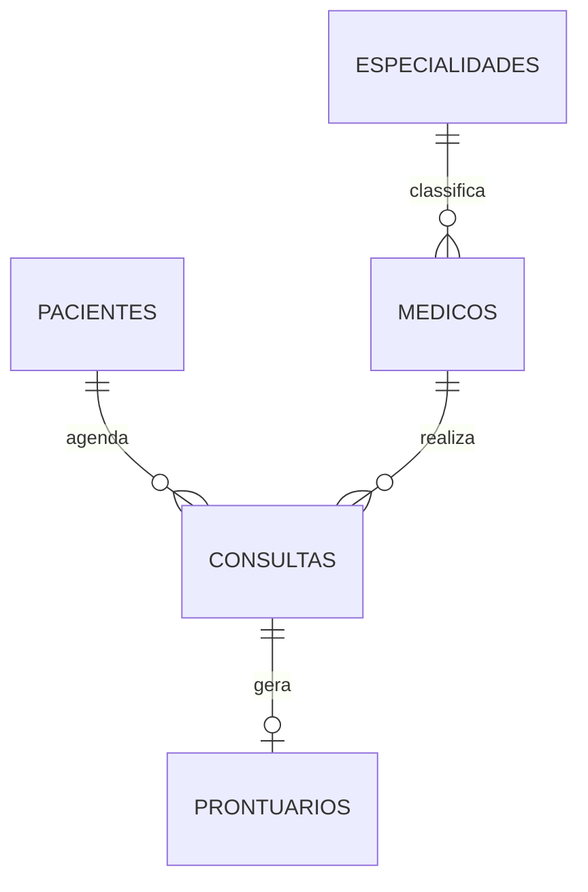

# 🏥 Sistema de Clínica Médica — Escopo Inicial

Projeto final da disciplina de Banco de Dados: modelagem e implementação do banco de dados de uma clínica médica de pequeno/médio porte.

---

## 👥 Integrantes

| Lucas Borges Krziminski | 022116 |

---

## 📁 Estrutura do repositório

```
clinica-medica-db/
├── README.md          # Escopo do projeto (este arquivo)
├── database/
│   └── init.sql       # Script de criação do banco, tabelas e regras de negócio
├── docs/
│   └── DER.md         # Diagrama Entidade-Relacionamento
└── src/               # Código da aplicação (próximas entregas)
```

---

# Parte 1 — Formação e Definição do Escopo

## Tema

**Sistema de Clínica Médica** — gestão de pacientes, médicos, agendamento de consultas e registro de atendimento (prontuário).

## Delimitação do escopo

Para evitar *scope creep*, esta primeira versão foca em **dois módulos**:

1. **Agendamento** — cadastro de pacientes e médicos e marcação de consultas.
2. **Atendimento** — registro do prontuário da consulta realizada.

**Fora do escopo** (possíveis evoluções futuras): faturamento de convênios, emissão de nota fiscal, controle de estoque de medicamentos, exames laboratoriais, telemedicina e portal do paciente.

## Requisitos Funcionais (RF)

| ID | Requisito |
|---|---|
| RF01 | O sistema deve permitir **cadastrar, editar e consultar pacientes** (nome, CPF, data de nascimento, contato). |
| RF02 | O sistema deve permitir **cadastrar médicos** com CRM, especialidade e valor da consulta. |
| RF03 | O sistema deve permitir **agendar uma consulta** para um paciente com um médico em uma data/hora. |
| RF04 | O sistema deve **impedir que um médico tenha duas consultas ativas no mesmo horário**. |
| RF05 | O sistema deve permitir **alterar o status da consulta** (agendada, confirmada, realizada, cancelada, faltou). |
| RF06 | O sistema deve permitir **registrar o prontuário** (queixa, diagnóstico, prescrição) de uma consulta realizada. |
| RF07 | O sistema deve permitir **listar a agenda** de um médico por dia e o **histórico de consultas** de um paciente. |

## Requisitos Não-Funcionais (RNF)

| ID | Requisito |
|---|---|
| RNF01 | **Consistência:** os dados de agendamento e de prontuário devem ser altamente consistentes — não pode haver dois agendamentos conflitantes nem prontuário ligado a uma consulta inexistente (integridade referencial e transações ACID). |
| RNF02 | **Segurança e privacidade:** os dados de saúde são dados pessoais sensíveis (LGPD, art. 11) e devem ter acesso restrito por perfil (recepção não acessa prontuário). |
| RNF03 | **Desempenho:** a consulta da agenda diária de um médico deve responder em menos de 1 segundo com até 100.000 consultas cadastradas. |
| RNF04 | **Disponibilidade:** o sistema deve estar disponível durante o horário de funcionamento da clínica (07h às 20h), com backup diário do banco. |

---

# Parte 2 — Entidades e Decisão Tecnológica

## Entidades principais

| Entidade | Descrição |
|---|---|
| **Paciente** | Pessoa atendida pela clínica. Guarda dados de identificação (CPF único) e contato. |
| **Médico** | Profissional que realiza o atendimento. Identificado pelo CRM, possui uma especialidade e um valor de consulta. |
| **Especialidade** | Área médica (Cardiologia, Pediatria, Clínica Geral…). Tabela de domínio que classifica os médicos. |
| **Consulta** | Evento central do sistema: liga **um paciente** a **um médico** em uma data/hora, com status e valor cobrado. |
| **Prontuário** | Registro clínico gerado a partir de uma consulta realizada (queixa, diagnóstico, prescrição). |

## Relacionamentos

- **Especialidade 1 : N Médico** — cada médico tem uma especialidade; uma especialidade agrupa vários médicos.
- **Paciente 1 : N Consulta** — um paciente pode ter muitas consultas ao longo do tempo.
- **Médico 1 : N Consulta** — um médico atende muitas consultas.
- **Paciente N : N Médico** — resolvido pela entidade associativa **Consulta**.
- **Consulta 1 : 0..1 Prontuário** — cada consulta realizada gera no máximo um prontuário.

O diagrama completo está em [`docs/DER.md`](docs/DER.md).

## Decisão tecnológica

### ✅ PostgreSQL (relacional)

## Justificativa

Escolhemos **PostgreSQL** porque o núcleo do sistema é o **agendamento de consultas**, uma operação em que a consistência é obrigatória: duas recepcionistas não podem marcar o mesmo médico no mesmo horário, e uma consulta não pode existir sem paciente e médico válidos. Isso exige **transações ACID**, **chaves estrangeiras** e **restrições declarativas** (`UNIQUE`, `CHECK`), que o PostgreSQL garante nativamente no próprio banco, sem depender da aplicação. Além disso, os dados da clínica são **fortemente estruturados e estáveis** — todo paciente tem CPF e data de nascimento, toda consulta tem médico, data e status — e as entidades são **muito relacionadas entre si** (paciente ↔ consulta ↔ médico ↔ especialidade). Os principais padrões de acesso são consultas com junções e filtros, como *"agenda do Dr. X no dia Y"*, *"histórico de consultas do paciente Z"* e *"faturamento por especialidade no mês"*, que são exatamente o ponto forte do SQL. Um modelo de documentos (MongoDB) só traria vantagem se os dados variassem muito de formato; no nosso caso, ele obrigaria a duplicar dados de médico e paciente dentro das consultas ou a reimplementar joins e validações na aplicação. Caso no futuro o prontuário precise guardar campos que variam por especialidade, o PostgreSQL ainda oferece o tipo **`JSONB`**, o que dá essa flexibilidade sem abrir mão da integridade do restante do modelo.

---

# Parte 3 — Tarefa de Casa (Desafio)

## Diagrama Entidade-Relacionamento



> Versão com todos os atributos, tipos e cardinalidades: [`docs/DER.md`](docs/DER.md).

## Script inicial

O arquivo [`database/init.sql`](database/init.sql) cria o banco `clinica_medica`, a tabela principal `pacientes` e as demais tabelas do escopo, além de alguns dados de exemplo.

**Como executar:**

```bash
psql -U postgres -f database/init.sql
```

## ⭐ Bônus — Regras de negócio no banco

As regras abaixo são garantidas pelo próprio PostgreSQL, ou seja, nenhum sistema que acesse o banco consegue gravar dados inválidos:

| Regra | Implementação |
|---|---|
| Valor da consulta não pode ser negativo | `CHECK (valor_consulta >= 0)` em `medicos` e `CHECK (valor >= 0)` em `consultas` |
| CPF deve ter exatamente 11 dígitos numéricos | `CHECK (cpf ~ '^[0-9]{11}$')` + `UNIQUE` |
| Status da consulta só aceita valores válidos | `CHECK (status IN ('agendada','confirmada','realizada','cancelada','faltou'))` |
| Duração da consulta entre 10 e 240 minutos | `CHECK (duracao_min BETWEEN 10 AND 240)` |
| Médico não pode ter duas consultas ativas no mesmo horário (RF04) | Índice único parcial `UNIQUE (medico_id, data_hora) WHERE status <> 'cancelada'` |
| Um prontuário por consulta | `UNIQUE (consulta_id)` em `prontuarios` |

Exemplo — este comando é **rejeitado** pelo banco:

```sql
INSERT INTO medicos (nome, crm, especialidade_id, valor_consulta)
VALUES ('Teste', '000000-SP', 1, -50);
-- ERROR: new row for relation "medicos" violates check constraint "ck_medicos_valor_consulta"
```

---

# Parte 4 — Reflexão

> **Por que a escolha do SGBD (Relacional vs. NoSQL) deve ser feita com base nos requisitos de acesso aos dados e não na preferência da equipe? Qual o impacto de uma escolha errada no início do projeto?**

O banco de dados é a fundação do sistema: todo o código da aplicação, as consultas e a infraestrutura são construídos em cima dele. Por isso, a escolha precisa partir de **como os dados serão gravados e lidos** — se são estruturados ou variáveis, se precisam de consistência forte ou toleram consistência eventual, se as consultas cruzam várias entidades (joins) ou buscam um documento inteiro por chave, e qual o volume e a escala esperados. A preferência da equipe ("já sabemos Mongo", "SQL é mais moderno/antigo") não diz nada sobre esses requisitos; ela é um fator secundário, que pode ser resolvido com estudo, enquanto um modelo inadequado acompanha o projeto pela vida toda.

Uma escolha errada no início gera custos que crescem com o tempo:

- **Gargalos de performance:** usar um banco de documentos para dados muito relacionados obriga a fazer vários "joins" na aplicação ou `$lookup` pesados; usar um relacional para dados muito variáveis gera tabelas genéricas (modelo EAV) com consultas lentas e difíceis de indexar.
- **Dificuldade de modelagem e perda de integridade:** sem chaves estrangeiras e transações, regras como "não agendar dois pacientes no mesmo horário" passam a depender do código, e qualquer falha gera dados inconsistentes — algo grave em contextos financeiros ou de saúde.
- **Custos desnecessários de infraestrutura:** para compensar o modelo errado, a equipe acaba adicionando caches, réplicas, filas ou servidores maiores, aumentando o custo de operação.
- **Retrabalho e migração:** trocar de SGBD com o sistema em produção significa reescrever consultas, migrar dados e testar tudo de novo — muito mais caro do que gastar tempo analisando requisitos no início.

No nosso caso, a análise dos requisitos (RNF01 – consistência, e as entidades fortemente relacionadas) apontou claramente para o modelo relacional, e não uma preferência pessoal.
