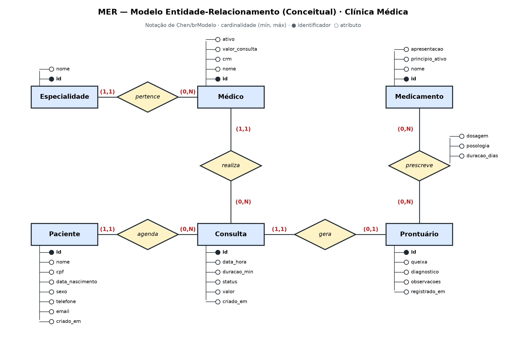
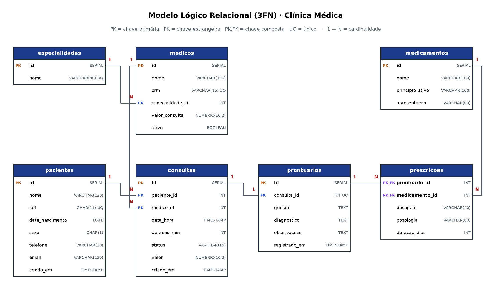

# 🏥 Sistema de Clínica Médica — Banco de Dados

Projeto final da disciplina de Banco de Dados: modelagem e implementação do banco de dados de uma clínica médica de pequeno/médio porte, usando **PostgreSQL**.

---

## 👥 Integrante

| Nome | RA |
|---|---|
| Lucas Borges Krziminski | 022116 |

---

## 📑 Entregas

| Semana | Conteúdo | Seção |
|---|---|---|
| 1 | Escopo, requisitos, entidades e decisão tecnológica | [Entrega 1](#entrega-1--escopo-inicial) |
| 2 | MER, modelo lógico, normalização (3FN), PK e FK | [Entrega 2](#entrega-2--mer-normalização-e-chaves) |

---

## 📁 Estrutura do repositório

```
clinica-medica-db/
├── README.md                       # Documentação do projeto (este arquivo)
├── database/
│   ├── init.sql                    # DDL: cria o banco e as tabelas (PK, FK, CHECK)
│   ├── 02_dados_teste.sql          # DML: dados de teste + consultas com JOIN
│   └── 03_testes_integridade.sql   # Bônus: comandos que violam PK/FK (devem falhar)
├── docs/
│   ├── DER.md                      # Diagramas + cardinalidades
│   ├── mer-conceitual.png / .pdf   # MER (modelo conceitual)
│   ├── modelo-logico.png / .pdf    # Modelo lógico (tabelas com PK/FK)
│   └── execucao/                   # Saída real da execução dos scripts no PostgreSQL
└── src/                            # Código da aplicação (próximas entregas)
```

### Como executar

```bash
psql -U postgres -f database/init.sql
psql -U postgres -d clinica_medica -f database/02_dados_teste.sql
psql -U postgres -d clinica_medica -f database/03_testes_integridade.sql
```

---
---

# Entrega 1 — Escopo Inicial

## Parte 1 — Formação e Definição do Escopo

### Tema

**Sistema de Clínica Médica** — gestão de pacientes, médicos, agendamento de consultas e registro de atendimento (prontuário).

### Delimitação do escopo

Para evitar *scope creep*, esta primeira versão foca em **dois módulos**:

1. **Agendamento** — cadastro de pacientes e médicos e marcação de consultas.
2. **Atendimento** — registro do prontuário da consulta realizada.

**Fora do escopo** (possíveis evoluções futuras): faturamento de convênios, emissão de nota fiscal, controle de estoque de medicamentos, exames laboratoriais, telemedicina e portal do paciente.

### Requisitos Funcionais (RF)

| ID | Requisito |
|---|---|
| RF01 | O sistema deve permitir **cadastrar, editar e consultar pacientes** (nome, CPF, data de nascimento, contato). |
| RF02 | O sistema deve permitir **cadastrar médicos** com CRM, especialidade e valor da consulta. |
| RF03 | O sistema deve permitir **agendar uma consulta** para um paciente com um médico em uma data/hora. |
| RF04 | O sistema deve **impedir que um médico tenha duas consultas ativas no mesmo horário**. |
| RF05 | O sistema deve permitir **alterar o status da consulta** (agendada, confirmada, realizada, cancelada, faltou). |
| RF06 | O sistema deve permitir **registrar o prontuário** (queixa, diagnóstico, prescrição) de uma consulta realizada. |
| RF07 | O sistema deve permitir **listar a agenda** de um médico por dia e o **histórico de consultas** de um paciente. |

### Requisitos Não-Funcionais (RNF)

| ID | Requisito |
|---|---|
| RNF01 | **Consistência:** os dados de agendamento e de prontuário devem ser altamente consistentes — não pode haver dois agendamentos conflitantes nem prontuário ligado a uma consulta inexistente (integridade referencial e transações ACID). |
| RNF02 | **Segurança e privacidade:** os dados de saúde são dados pessoais sensíveis (LGPD, art. 11) e devem ter acesso restrito por perfil (recepção não acessa prontuário). |
| RNF03 | **Desempenho:** a consulta da agenda diária de um médico deve responder em menos de 1 segundo com até 100.000 consultas cadastradas. |
| RNF04 | **Disponibilidade:** o sistema deve estar disponível durante o horário de funcionamento da clínica (07h às 20h), com backup diário do banco. |

## Parte 2 — Entidades e Decisão Tecnológica

### Entidades principais

| Entidade | Descrição |
|---|---|
| **Paciente** | Pessoa atendida pela clínica. Guarda dados de identificação (CPF único) e contato. |
| **Médico** | Profissional que realiza o atendimento. Identificado pelo CRM, possui uma especialidade e um valor de consulta. |
| **Especialidade** | Área médica (Cardiologia, Pediatria, Clínica Geral…). Tabela de domínio que classifica os médicos. |
| **Consulta** | Evento central do sistema: liga **um paciente** a **um médico** em uma data/hora, com status e valor cobrado. |
| **Prontuário** | Registro clínico gerado a partir de uma consulta realizada (queixa, diagnóstico, prescrição). |

> Na Entrega 2, a normalização fez surgir a entidade **Medicamento** e a tabela associativa **Prescrição** (ver [Entrega 2](#entrega-2--mer-normalização-e-chaves)).

### Relacionamentos

- **Especialidade 1 : N Médico** — cada médico tem uma especialidade; uma especialidade agrupa vários médicos.
- **Paciente 1 : N Consulta** — um paciente pode ter muitas consultas ao longo do tempo.
- **Médico 1 : N Consulta** — um médico atende muitas consultas.
- **Paciente N : N Médico** — resolvido pela entidade associativa **Consulta**.
- **Consulta 1 : 0..1 Prontuário** — cada consulta realizada gera no máximo um prontuário.

### Decisão tecnológica: ✅ PostgreSQL (relacional)

### Justificativa

Escolhemos **PostgreSQL** porque o núcleo do sistema é o **agendamento de consultas**, uma operação em que a consistência é obrigatória: duas recepcionistas não podem marcar o mesmo médico no mesmo horário, e uma consulta não pode existir sem paciente e médico válidos. Isso exige **transações ACID**, **chaves estrangeiras** e **restrições declarativas** (`UNIQUE`, `CHECK`), que o PostgreSQL garante nativamente no próprio banco, sem depender da aplicação. Além disso, os dados da clínica são **fortemente estruturados e estáveis** — todo paciente tem CPF e data de nascimento, toda consulta tem médico, data e status — e as entidades são **muito relacionadas entre si** (paciente ↔ consulta ↔ médico ↔ especialidade). Os principais padrões de acesso são consultas com junções e filtros, como *"agenda do Dr. X no dia Y"*, *"histórico de consultas do paciente Z"* e *"faturamento por especialidade no mês"*, que são exatamente o ponto forte do SQL. Um modelo de documentos (MongoDB) só traria vantagem se os dados variassem muito de formato; no nosso caso, ele obrigaria a duplicar dados de médico e paciente dentro das consultas ou a reimplementar joins e validações na aplicação. Caso no futuro o prontuário precise guardar campos que variam por especialidade, o PostgreSQL ainda oferece o tipo **`JSONB`**, o que dá essa flexibilidade sem abrir mão da integridade do restante do modelo.

## Parte 3 — Tarefa de Casa (Desafio)

- **DER:** ver [`docs/DER.md`](docs/DER.md).
- **Script inicial:** [`database/init.sql`](database/init.sql) cria o banco `clinica_medica` e as tabelas, começando pela tabela principal `pacientes`.

### ⭐ Bônus — Regras de negócio no banco

| Regra | Implementação |
|---|---|
| Valor da consulta não pode ser negativo | `CHECK (valor_consulta >= 0)` em `medicos` e `CHECK (valor >= 0)` em `consultas` |
| CPF deve ter exatamente 11 dígitos numéricos | `CHECK (cpf ~ '^[0-9]{11}$')` + `UNIQUE` |
| Status da consulta só aceita valores válidos | `CHECK (status IN ('agendada','confirmada','realizada','cancelada','faltou'))` |
| Duração da consulta entre 10 e 240 minutos | `CHECK (duracao_min BETWEEN 10 AND 240)` |
| Médico não pode ter duas consultas ativas no mesmo horário (RF04) | Índice único parcial `UNIQUE (medico_id, data_hora) WHERE status <> 'cancelada'` |
| Um prontuário por consulta | `UNIQUE (consulta_id)` em `prontuarios` |

## Parte 4 — Reflexão

> **Por que a escolha do SGBD (Relacional vs. NoSQL) deve ser feita com base nos requisitos de acesso aos dados e não na preferência da equipe? Qual o impacto de uma escolha errada no início do projeto?**

O banco de dados é a fundação do sistema: todo o código da aplicação, as consultas e a infraestrutura são construídos em cima dele. Por isso, a escolha precisa partir de **como os dados serão gravados e lidos** — se são estruturados ou variáveis, se precisam de consistência forte ou toleram consistência eventual, se as consultas cruzam várias entidades (joins) ou buscam um documento inteiro por chave, e qual o volume e a escala esperados. A preferência da equipe ("já sabemos Mongo", "SQL é mais moderno/antigo") não diz nada sobre esses requisitos; ela é um fator secundário, que pode ser resolvido com estudo, enquanto um modelo inadequado acompanha o projeto pela vida toda.

Uma escolha errada no início gera custos que crescem com o tempo:

- **Gargalos de performance:** usar um banco de documentos para dados muito relacionados obriga a fazer vários "joins" na aplicação ou `$lookup` pesados; usar um relacional para dados muito variáveis gera tabelas genéricas (modelo EAV) com consultas lentas e difíceis de indexar.
- **Dificuldade de modelagem e perda de integridade:** sem chaves estrangeiras e transações, regras como "não agendar dois pacientes no mesmo horário" passam a depender do código, e qualquer falha gera dados inconsistentes — algo grave em contextos financeiros ou de saúde.
- **Custos desnecessários de infraestrutura:** para compensar o modelo errado, a equipe acaba adicionando caches, réplicas, filas ou servidores maiores, aumentando o custo de operação.
- **Retrabalho e migração:** trocar de SGBD com o sistema em produção significa reescrever consultas, migrar dados e testar tudo de novo — muito mais caro do que gastar tempo analisando requisitos no início.

No nosso caso, a análise dos requisitos (RNF01 – consistência, e as entidades fortemente relacionadas) apontou claramente para o modelo relacional, e não uma preferência pessoal.

---
---

# Entrega 2 — MER, Normalização e Chaves

## Parte 1 — Modelagem Conceitual (MER)



📄 Versão em PDF: [`docs/mer-conceitual.pdf`](docs/mer-conceitual.pdf)

O MER foi feito na notação de Chen (a mesma do brModelo): **retângulos** são entidades, **losangos** são relacionamentos, **pirulitos** são atributos (● = identificador) e os pares **(mín, máx)** indicam a cardinalidade. Nesta etapa ainda **não existem tabelas nem FKs** — só o "mundo real" da clínica.

### Entidades e atributos

| Entidade | Identificador | Atributos |
|---|---|---|
| **Paciente** | id | nome, cpf, data_nascimento, sexo, telefone, email, criado_em |
| **Médico** | id | nome, crm, valor_consulta, ativo |
| **Especialidade** | id | nome |
| **Consulta** | id | data_hora, duracao_min, status, valor, criado_em |
| **Prontuário** | id | queixa, diagnostico, observacoes, registrado_em |
| **Medicamento** | id | nome, principio_ativo, apresentacao |

### Relacionamentos e cardinalidades

| Relacionamento | Tipo | (mín, máx) | Leitura |
|---|---|---|---|
| Especialidade — **pertence** — Médico | **1:N** | (1,1) — (0,N) | Todo médico tem exatamente uma especialidade; uma especialidade pode ter vários médicos. |
| Paciente — **agenda** — Consulta | **1:N** | (1,1) — (0,N) | Toda consulta é de um paciente; um paciente pode ter várias consultas. |
| Médico — **realiza** — Consulta | **1:N** | (1,1) — (0,N) | Toda consulta tem um médico; um médico atende várias consultas. |
| Consulta — **gera** — Prontuário | **1:1** | (1,1) — (0,1) | Uma consulta gera no máximo um prontuário; todo prontuário vem de uma consulta. |
| Prontuário — **prescreve** — Medicamento | **N:N** | (0,N) — (0,N) | Uma receita tem vários remédios e um remédio aparece em várias receitas. O relacionamento tem atributos próprios: **dosagem, posologia, duracao_dias**. |

> **Por que Consulta é entidade e não um relacionamento N:N entre Paciente e Médico?** Porque o mesmo paciente pode consultar o mesmo médico várias vezes, e cada consulta tem vida própria (status, valor, data) e ainda se relaciona com o Prontuário. Por isso ela ganhou identificador próprio.

## Parte 2 — Modelo Lógico, Normalização e Chaves



📄 Versão em PDF: [`docs/modelo-logico.pdf`](docs/modelo-logico.pdf)

### Do conceitual para o lógico

| Regra aplicada | Onde |
|---|---|
| Cada **entidade** vira uma **tabela**, e o identificador vira **PK** | Todas as tabelas |
| Relacionamento **1:N** → a **FK vai na tabela do lado N** | `medicos.especialidade_id`, `consultas.paciente_id`, `consultas.medico_id` |
| Relacionamento **1:1** → FK + `UNIQUE` em um dos lados | `prontuarios.consulta_id` (FK + UNIQUE) |
| Relacionamento **N:N** → **tabela associativa** com **PK composta** pelas duas FKs | `prescricoes (prontuario_id, medicamento_id)` |
| Atributos do relacionamento N:N vão para a tabela associativa | `dosagem`, `posologia`, `duracao_dias` |

### Chaves primárias (PK) e estrangeiras (FK)

| Tabela | PK | FK → referência |
|---|---|---|
| `especialidades` | `id` | — |
| `pacientes` | `id` | — |
| `medicamentos` | `id` | — |
| `medicos` | `id` | `especialidade_id` → `especialidades(id)` |
| `consultas` | `id` | `paciente_id` → `pacientes(id)` · `medico_id` → `medicos(id)` |
| `prontuarios` | `id` | `consulta_id` → `consultas(id)` (também `UNIQUE`) |
| `prescricoes` | **(`prontuario_id`, `medicamento_id`)** — composta | `prontuario_id` → `prontuarios(id)` · `medicamento_id` → `medicamentos(id)` |

Além das chaves, existem **chaves candidatas** com `UNIQUE`: `pacientes.cpf`, `medicos.crm`, `especialidades.nome` e `medicamentos (nome, apresentacao)`. Optamos por PK numérica (`SERIAL`) porque CPF/CRM podem ser digitados errados e precisar de correção, e uma PK nunca deve mudar.

### Normalização

**1ª Forma Normal (1FN) — atributos atômicos, sem grupos repetitivos**

- Na Entrega 1, `prontuarios.prescricao` era um campo de texto onde o médico escrevia vários remédios juntos (ex.: `"Amoxicilina 500mg 8/8h; Dipirona 500mg 6/6h"`). Isso é um **grupo repetitivo** dentro de uma coluna e **viola a 1FN**: não dá para responder "quantas vezes a Dipirona foi receitada?" sem quebrar texto.
- **Correção:** criamos a tabela `medicamentos` e a tabela associativa `prescricoes`, com **uma linha por remédio receitado**.
- Os demais campos já são atômicos: cada paciente tem um CPF, uma data de nascimento e um telefone principal.

**2ª Forma Normal (2FN) — sem dependência parcial da chave**

- Só faz sentido checar a 2FN em tabelas com **PK composta**. No nosso modelo, a única é `prescricoes (prontuario_id, medicamento_id)`.
- `dosagem`, `posologia` e `duracao_dias` dependem **das duas colunas juntas** (a dosagem é *daquele* remédio *naquela* receita) → ✅ OK.
- O **nome** e o **princípio ativo** do remédio dependeriam só de `medicamento_id` (dependência parcial). Por isso eles **ficam na tabela `medicamentos`** e não em `prescricoes`.
- As outras tabelas têm PK simples (`id`), então não podem ter dependência parcial → já estão na 2FN.

**3ª Forma Normal (3FN) — sem dependência transitiva**

| Tentação | Por que quebraria a 3FN | Solução adotada |
|---|---|---|
| Guardar `especialidade_nome` em `medicos` | `id → especialidade_id → nome` (transitiva) | Só a FK `especialidade_id`; o nome fica em `especialidades` |
| Guardar `paciente_id` / `medico_id` em `prontuarios` | Já são obtidos por `prontuario → consulta → paciente/médico` | Só a FK `consulta_id` |
| Guardar `paciente_nome` / `telefone` em `consultas` | Dependem de `paciente_id`, não da consulta | Só a FK `paciente_id` |
| Guardar `idade` em `pacientes` | Derivada de `data_nascimento` (e muda todo ano) | Calculada na consulta: `AGE(data_nascimento)` |

> **Decisão consciente — `consultas.valor`:** pode parecer cópia de `medicos.valor_consulta`, mas **não é dependência transitiva**. O preço do médico muda com o tempo; o valor da consulta é o preço **combinado naquele dia** (um fato histórico da consulta). Se o médico reajustar o preço, as consultas antigas não podem mudar de valor. Por isso o valor depende da própria consulta (PK) e pode ser armazenado.

### Script DDL

O script completo está em [`database/init.sql`](database/init.sql). Todas as constraints têm **nome explícito** (`pk_`, `fk_`, `uq_`, `ck_`), o que deixa as mensagens de erro mais claras. Exemplo da tabela associativa:

```sql
CREATE TABLE prescricoes (
    prontuario_id   INT          NOT NULL,
    medicamento_id  INT          NOT NULL,
    dosagem         VARCHAR(40)  NOT NULL,
    posologia       VARCHAR(80)  NOT NULL,
    duracao_dias    INT          NOT NULL,

    CONSTRAINT pk_prescricoes             PRIMARY KEY (prontuario_id, medicamento_id),
    CONSTRAINT fk_prescricoes_prontuario  FOREIGN KEY (prontuario_id)  REFERENCES prontuarios (id),
    CONSTRAINT fk_prescricoes_medicamento FOREIGN KEY (medicamento_id) REFERENCES medicamentos (id),
    CONSTRAINT ck_prescricoes_duracao     CHECK (duracao_dias > 0)
);
```

## Parte 3 — Tarefa de Casa (Desafio)

### Execução no PostgreSQL

Os scripts foram executados no **PostgreSQL 16.2**. A saída completa de cada execução está em [`docs/execucao/`](docs/execucao/):

| Script | O que faz | Saída |
|---|---|---|
| `init.sql` | Cria o banco e as 7 tabelas | [01_init.txt](docs/execucao/01_init.txt) |
| `02_dados_teste.sql` | Insere dados em 7 tabelas relacionadas e faz `JOIN` entre elas | [02_dados_teste.txt](docs/execucao/02_dados_teste.txt) |
| `03_testes_integridade.sql` | Tenta inserir dados inválidos (bônus) | [03_testes_integridade.txt](docs/execucao/03_testes_integridade.txt) |

**Prova de que as FKs ligam as tabelas** — `JOIN` entre `consultas`, `pacientes`, `medicos` e `especialidades`:

```
 consulta |    paciente    |     medico      | especialidade |      data_hora      |   status
----------+----------------+-----------------+---------------+---------------------+------------
        1 | Carlos Pereira | Dra. Ana Souza  | Clínica Geral | 2026-12-01 09:00:00 | realizada
        3 | Mariana Costa  | Dra. Ana Souza  | Clínica Geral | 2026-12-01 10:00:00 | realizada
        4 | João Silva     | Dra. Paula Reis | Pediatria     | 2026-12-02 08:30:00 | confirmada
        2 | Carlos Pereira | Dr. Bruno Lima  | Cardiologia   | 2026-12-03 14:00:00 | agendada
```

E a receita normalizada (N:N `prontuarios` ↔ `medicamentos` via `prescricoes`):

```
    paciente    |      diagnostico      | medicamento |   dosagem    |            posologia
----------------+-----------------------+-------------+--------------+---------------------------------
 Carlos Pereira | Amigdalite bacteriana | Amoxicilina | 1 cápsula    | de 8 em 8 horas
 Carlos Pereira | Amigdalite bacteriana | Dipirona    | 1 comprimido | de 6 em 6 horas se houver febre
 Mariana Costa  | Cefaleia tensional    | Dipirona    | 1 comprimido | de 6 em 6 horas se houver dor
```

### ⭐ Bônus — Violações de integridade

Todos os comandos abaixo foram **rejeitados pelo banco** (mensagens reais da execução):

| # | Tentativa | Erro retornado pelo PostgreSQL |
|---|---|---|
| 1 | Médico com `especialidade_id = 99` (não existe) | `violates foreign key constraint "fk_medicos_especialidade"` — *Key (especialidade_id)=(99) is not present in table "especialidades".* |
| 2 | Consulta para `paciente_id = 500` (não existe) | `violates foreign key constraint "fk_consultas_paciente"` — *Key (paciente_id)=(500) is not present in table "pacientes".* |
| 3 | Especialidade com `id = 1` (já existe) | `duplicate key value violates unique constraint "pk_especialidades"` — *Key (id)=(1) already exists.* |
| 4 | Mesmo remédio 2x na mesma receita | `duplicate key value violates unique constraint "pk_prescricoes"` — *Key (prontuario_id, medicamento_id)=(1, 2) already exists.* |
| 5 | Excluir paciente que tem consultas | `update or delete on table "pacientes" violates foreign key constraint "fk_consultas_paciente"` — *Key (id)=(1) is still referenced from table "consultas".* |
| 6 | Paciente com CPF já cadastrado | `duplicate key value violates unique constraint "uq_pacientes_cpf"` |
| 7 | Mesmo médico, mesmo horário | `duplicate key value violates unique constraint "ux_consultas_medico_horario"` |
| 8 | Médico com valor de consulta negativo | `violates check constraint "ck_medicos_valor_consulta"` |

Ao final, a contagem de linhas mostra que **nenhum registro inválido foi gravado**.

### 🧩 Desafio de Normalização — da planilha à 3FN

Antes de ter um sistema, muitas clínicas controlam os atendimentos numa **planilha única**, como esta:

**`atendimentos` (desnormalizada)**

| data_hora | paciente | cpf | telefone | medico | crm | especialidade | medicamentos |
|---|---|---|---|---|---|---|---|
| 01/12 09:00 | Carlos Pereira | 12345678901 | 98999990001 | Ana Souza | 123456-MA | Clínica Geral | Amoxicilina 500mg 8/8h; Dipirona 500mg 6/6h |
| 01/12 10:00 | Mariana Costa | 98765432100 | 98999990002 | Ana Souza | 123456-MA | Clínica Geral | Dipirona 500mg 6/6h |
| 03/12 14:00 | Carlos Pereira | 12345678901 | 98999990001 | Bruno Lima | 654321-MA | Cardiologia | — |
| 02/12 08:30 | João Silva | 11122233344 | 98999990003 | Paula Reis | 111222-MA | Pediatria | — |

**Anomalias que essa tabela causa:**

- **Redundância:** nome, CPF e telefone do Carlos aparecem em cada consulta dele; os dados da Dra. Ana e da especialidade se repetem em cada atendimento.
- **Anomalia de atualização:** se o Carlos trocar de telefone, é preciso alterar **todas** as linhas dele. Se esquecer uma, o sistema passa a ter **dois telefones diferentes** para a mesma pessoa.
- **Anomalia de inserção:** não dá para cadastrar um **médico novo** (ou um paciente novo) **sem inventar uma consulta**, porque cada linha é um atendimento.
- **Anomalia de exclusão:** se a única consulta do João for apagada, **perdemos que a Dra. Paula existe e que a clínica atende Pediatria**.
- **Violação da 1FN:** a coluna `medicamentos` guarda vários valores numa célula só.

**Como a normalização resolveu:**

1. **1FN:** a coluna `medicamentos` foi quebrada em linhas → nasceram `medicamentos` e `prescricoes` (uma linha por remédio).
2. **2FN:** em `prescricoes`, o nome do remédio dependia só de `medicamento_id` → ficou em `medicamentos`.
3. **3FN:** os dados do paciente dependiam do CPF, e não do atendimento; os do médico dependiam do CRM; a especialidade dependia do médico → cada grupo virou sua própria tabela (`pacientes`, `medicos`, `especialidades`), e `consultas` guarda só as **FKs**.

Resultado: o telefone do Carlos agora existe em **um único lugar** (`pacientes`), um médico pode ser cadastrado antes de atender, e apagar uma consulta não apaga mais nenhum médico ou especialidade.

## Parte 4 — Reflexão

> **Por que a normalização (até a 3FN) é crucial para evitar anomalias de inserção, atualização e exclusão? Qual o papel da Chave Primária (PK) e da Chave Estrangeira (FK) para garantir a integridade dos dados?**

A normalização é crucial porque a raiz das três anomalias é a **redundância**, ou seja, a mesma informação guardada em mais de um lugar. Quando um dado se repete, toda **atualização** precisa ser feita em várias linhas, e basta esquecer uma para o banco ficar **inconsistente** (o mesmo paciente com dois telefones). Quando informações de assuntos diferentes ficam na mesma tabela, uma não pode existir sem a outra: não se consegue **inserir** um médico sem uma consulta, e ao **excluir** a última consulta perde-se o médico junto. Aplicando a 1FN, 2FN e 3FN, cada fato passa a ser guardado **uma única vez, na tabela do assunto a que pertence**, e cada atributo depende "da chave, da chave inteira e de nada além da chave". Assim, atualizar é alterar uma linha, inserir não exige dados inventados e excluir não apaga informação de outro assunto. Um benefício extra é a economia de espaço e índices menores.

A **Chave Primária (PK)** garante a **integridade de entidade**: cada registro é **único e identificável**, nunca nulo e nunca duplicado. É ela que permite apontar para "este paciente" sem ambiguidade (o teste 3 mostrou o banco recusando um `id` repetido, e o teste 4 recusando o mesmo remédio duas vezes na mesma receita). A **Chave Estrangeira (FK)** garante a **integridade referencial**: um registro só pode apontar para outro **que realmente existe**, e o banco impede que um registro "pai" seja apagado enquanto tiver "filhos". Assim, **nenhum relacionamento fica órfão**: não existe consulta de paciente inexistente (teste 2), médico de especialidade inexistente (teste 1) ou consulta sem paciente porque o paciente foi apagado (teste 5). Como essas regras ficam **no próprio banco**, e não só no código da aplicação, elas valem para qualquer sistema, script ou usuário que acesse os dados. É isso que sustenta a confiabilidade dos sistemas transacionais (OLTP).
