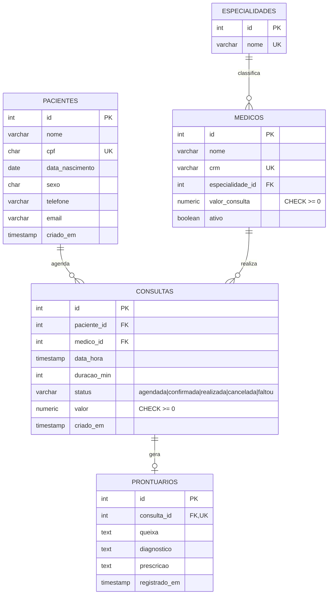

# Diagrama Entidade-Relacionamento (DER)

O diagrama abaixo está em [Mermaid](https://mermaid.js.org/) e é renderizado automaticamente pelo GitHub.

## Cardinalidades

| Relacionamento | Cardinalidade | Leitura |
|---|---|---|
| Especialidade → Médico | 1 : N | Uma especialidade tem vários médicos; cada médico tem uma especialidade principal. |
| Paciente → Consulta | 1 : N | Um paciente pode ter várias consultas; cada consulta é de um paciente. |
| Médico → Consulta | 1 : N | Um médico atende várias consultas; cada consulta tem um médico. |
| Consulta → Prontuário | 1 : 0..1 | Uma consulta gera no máximo um registro de prontuário (só quando é realizada). |

> Paciente e Médico têm um relacionamento **N:N** entre si, resolvido pela tabela associativa `consultas`.
