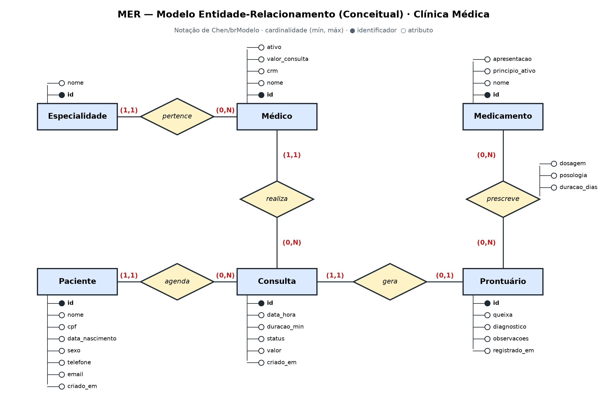
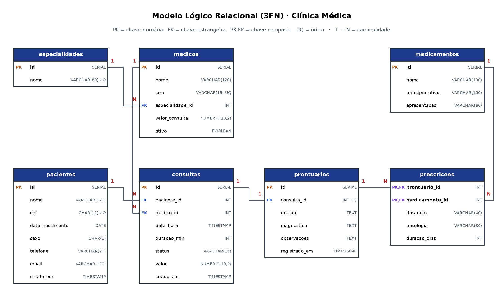
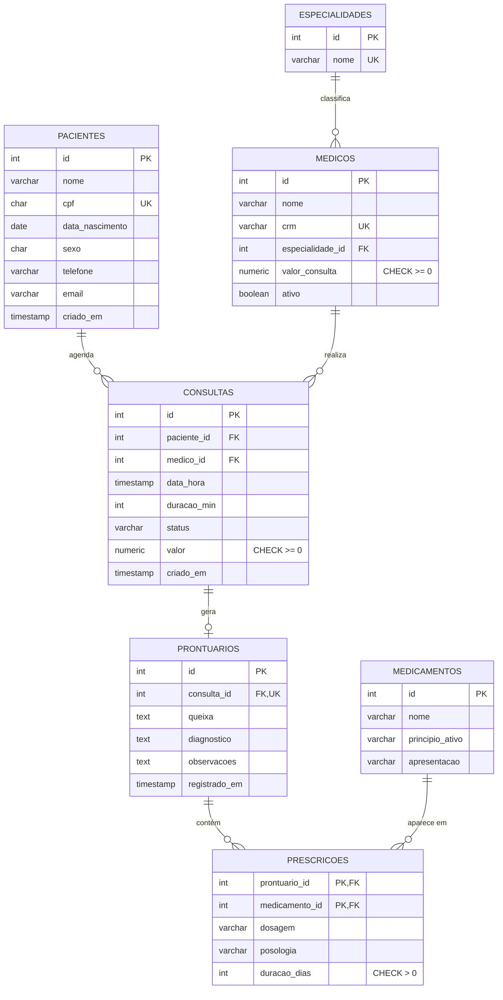

# Diagramas do banco de dados

| Diagrama | Imagem | PDF |
|---|---|---|
| MER — Modelo Entidade-Relacionamento (conceitual) | [mer-conceitual.png](mer-conceitual.png) | [mer-conceitual.pdf](mer-conceitual.pdf) |
| Modelo Lógico Relacional (3FN) | [modelo-logico.png](modelo-logico.png) | [modelo-logico.pdf](modelo-logico.pdf) |

## MER (conceitual)

## Modelo lógico (tabelas, PK e FK)

## Versão em Mermaid (renderizada pelo GitHub)

## Cardinalidades

| Relacionamento | Tipo | Cardinalidade (mín, máx) | Leitura |
|---|---|---|---|
| Especialidade — *pertence* — Médico | 1:N | (1,1) — (0,N) | Todo médico tem exatamente uma especialidade; uma especialidade pode ter vários médicos (ou nenhum). |
| Paciente — *agenda* — Consulta | 1:N | (1,1) — (0,N) | Toda consulta é de um paciente; um paciente pode ter várias consultas. |
| Médico — *realiza* — Consulta | 1:N | (1,1) — (0,N) | Toda consulta tem um médico; um médico atende várias consultas. |
| Consulta — *gera* — Prontuário | 1:1 | (1,1) — (0,1) | Uma consulta gera no máximo um prontuário (só quando é realizada). |
| Prontuário — *prescreve* — Medicamento | N:N | (0,N) — (0,N) | Uma receita pode ter vários remédios; um remédio aparece em várias receitas. Vira a tabela `prescricoes`. |
